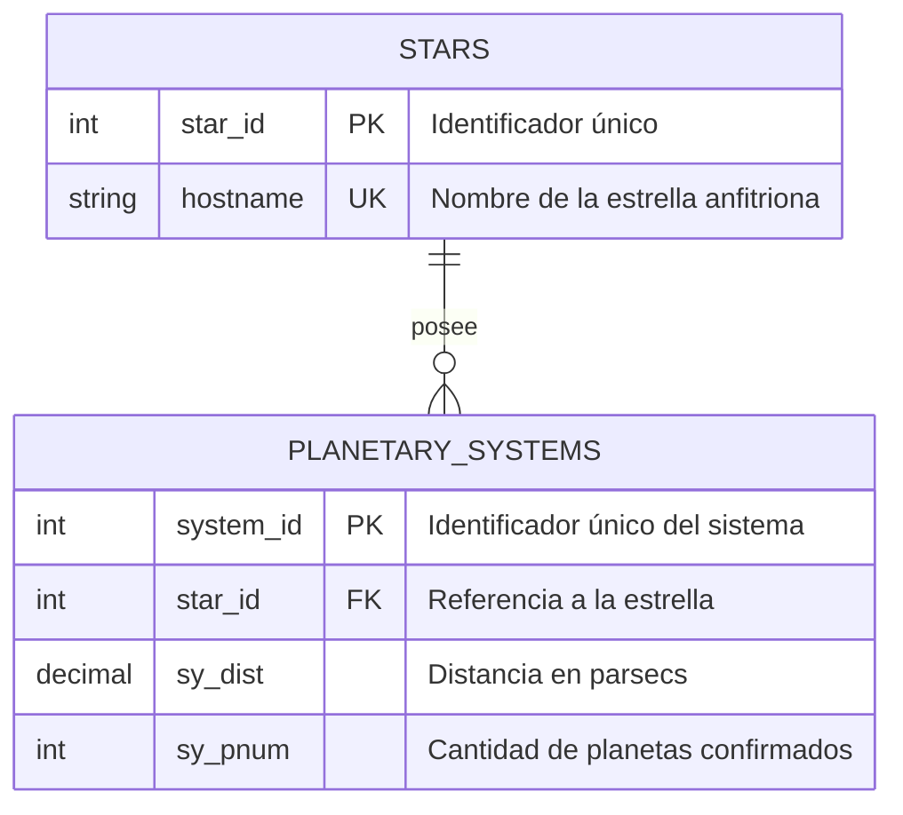

# 01. Fuente de datos: AWS RDS MariaDB

## 1. Descripción del caso de estudio

Esta primera fuente de datos utiliza **Amazon RDS con MariaDB** para almacenar información estructurada y normalizada sobre las estrellas anfitrionas y sus respectivos sistemas planetarios.

Los datos se obtienen del [NASA Exoplanet Archive](https://exoplanetarchive.ipac.caltech.edu/) mediante su servicio TAP (Table Access Protocol). Posteriormente, el script `insert_data.py`, ejecutado desde la instancia Amazon EC2, procesa la información y la inserta de forma transaccional en la base de datos RDS.

> **Infraestructura como Código (IaC):**
> Toda la infraestructura subyacente (VPC, subredes, grupos de seguridad, instancia EC2 y la base de datos RDS MariaDB) se despliega de manera automatizada y reproducible mediante la plantilla de AWS CloudFormation ubicada en [../infraestructura/infraestructura.yaml](../infraestructura/infraestructura.yaml). El despliegue detallado paso a paso del stack se encuentra documentado en el [README principal de Fuentes de Datos](../README.md).

---

## 2. Arquitectura de la fuente relacional

```text
NASA Exoplanet Archive (TAP API)
              |
              v
        Amazon EC2
   (Python + PyMySQL)
              |
              | TCP 3306 (VPC Privada)
              v
       Amazon RDS MariaDB
        (exoplanets_db)
           /       \
        stars    planetary_systems
```

La comunicación entre EC2 y RDS se realiza dentro de la misma VPC. El Security Group de RDS autoriza exclusivamente el tráfico entrante al puerto 3306 originado desde el Security Group de la instancia EC2.

---

## 3. Modelo de datos y diseño relacional

La base de datos `exoplanets_db` implementa un modelo normalizado de dos tablas relacionadas mediante la clave foránea `star_id`.



### 3.1. Definición de tablas (`create_tables.sql`)

```sql
CREATE TABLE stars (
    star_id INT AUTO_INCREMENT PRIMARY KEY,
    hostname VARCHAR(255) NOT NULL UNIQUE
) ENGINE=InnoDB;

CREATE TABLE planetary_systems (
    system_id INT AUTO_INCREMENT PRIMARY KEY,
    star_id INT NOT NULL UNIQUE,
    sy_dist DECIMAL(12,4),
    sy_pnum INT,
    FOREIGN KEY (star_id)
        REFERENCES stars(star_id)
) ENGINE=InnoDB;
```

---

## 4. Extracción y carga automatizada (`insert_data.py`)

### 4.1. Consulta ADQL a NASA TAP

Para poblar las tablas, se consulta la tabla oficial `ps` del NASA Exoplanet Archive agrupando por estrella anfitriona (`hostname`), garantizando una fila por sistema:

```sql
SELECT hostname,
       MAX(sy_dist) AS sy_dist,
       MAX(sy_pnum) AS sy_pnum
FROM ps
WHERE default_flag = 1
  AND hostname IS NOT NULL
GROUP BY hostname
ORDER BY hostname;
```

### 4.2. Variables de entorno requeridas

El script `insert_data.py` gestiona la conexión mediante variables de entorno para garantizar la seguridad de las credenciales:

```bash
export DB_HOST="<ENDPOINT_RDS_OBTENIDO_DE_CLOUDFORMATION>"
export DB_USER="admin_exoplanets"
export DB_PASSWORD="<TU_CONTRASENA_CONFIGURADA>"
export DB_NAME="exoplanets_db"
export DB_PORT="3306"
```

### 4.3. Ejecución del script

```bash
# Activar entorno virtual e instalar dependencias
python3 -m venv .venv
source .venv/bin/activate
pip install requests pymysql

# Ejecutar la inserción
python insert_data.py
```

### 4.4. Resultado obtenido

```text
Registros recibidos: 4862
Carga de datos completada correctamente.
Estrellas registradas: 4862
Sistemas registrados: 4862
```

---

## 5. Validación SQL de los datos almacenados

Desde el cliente MariaDB en la instancia EC2:

```bash
mysql -h $DB_HOST -P 3306 -u $DB_USER -p exoplanets_db
```

### 5.1. Conteo de registros

```sql
SELECT COUNT(*) FROM stars;
-- Resultado: 4862

SELECT COUNT(*) FROM planetary_systems;
-- Resultado: 4862
```

### 5.2. Verificación de integridad referencial (JOIN)

```sql
SELECT s.hostname, p.sy_dist, p.sy_pnum
FROM stars s
JOIN planetary_systems p ON s.star_id = p.star_id
LIMIT 5;
```

### 5.3. Análisis de valores nulos

```sql
SELECT
    COUNT(*) AS total,
    SUM(sy_dist IS NULL) AS distancias_faltantes,
    SUM(sy_pnum IS NULL) AS cantidades_faltantes
FROM planetary_systems;
```

| Métrica | Valor |
|---|---:|
| Total de registros | 4.862 |
| Distancias faltantes (`NULL`) | 107 |
| Cantidad de planetas faltantes (`NULL`) | 0 |

---

## 6. Resumen de la fuente

| Parámetro | Valor |
|---|---|
| **Motor** | MariaDB 11.8.x |
| **Instancia RDS** | `exoplanets-db` (`db.t3.micro`) |
| **Acceso público** | Deshabilitado (solo accesible vía EC2 en subred privada) |
| **Estrellas almacenadas** | 4.862 |
| **Sistemas almacenados** | 4.862 |
| **Rol en el proyecto** | Proveer la dimensión de estrellas y sistemas planetarios (`hostname`, `sy_dist`, `sy_pnum`) para cruzar con las demás fuentes en el Data Lake. |

---

## 7. Estructura de archivos

```text
01_rds_mariadb/
├── create_tables.sql         # Definición de tablas relacionales
├── insert_data.py            # Extractor y cargador automatizado
└── README.md                 # Documentación técnica de la fuente
```
