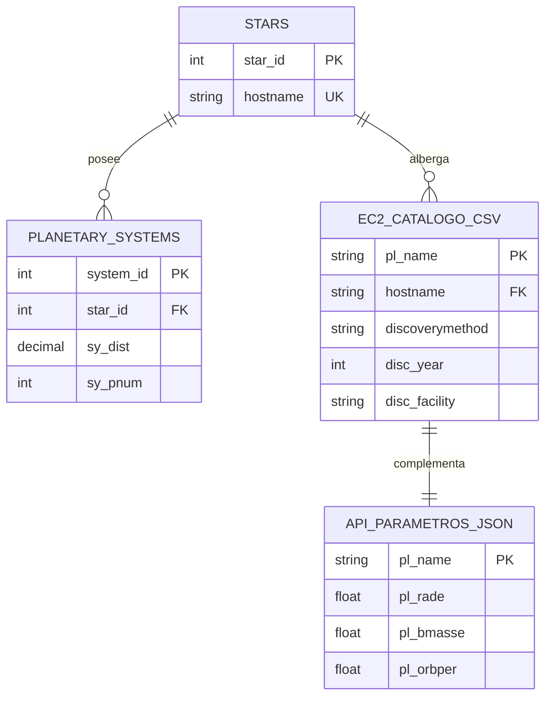

# Punto 2: Fuentes de Datos e Infraestructura Base

## 1. Introducción y propósito

Para responder a las preguntas de negocio del proyecto sobre las características físicas y orbitales de los exoplanetas y sus sistemas planetarios, se diseñó e implementó una arquitectura con **tres fuentes de datos heterogéneas**:

1. **Base de Datos Relacional:** Amazon RDS con MariaDB (`exoplanets_db`), conteniendo tablas de estrellas y sistemas planetarios.
2. **Archivos en Servidor:** Instancia Amazon EC2 con el catálogo oficial de exoplanetas confirmados en formato CSV.
3. **URL / API Externa:** Consulta dinámica a la API pública Table Access Protocol (TAP) del NASA Exoplanet Archive.

La infraestructura en la nube para soportar estas fuentes se despliega como **Infraestructura como Código (IaC)** mediante una plantilla de **AWS CloudFormation** ([infraestructura/infraestructura.yaml](infraestructura/infraestructura.yaml)).

---

## 2. Matriz de integración de fuentes de datos

| Fuente | Tecnología | Rol en la arquitectura | Archivos / Tablas | Claves de enlace | Variables aportadas |
|---|---|---|---|---|---|
| **1. Base de Datos** | AWS RDS MariaDB | Almacén relacional de estrellas y sistemas | Tablas `stars`, `planetary_systems` | `hostname`, `star_id` | `hostname`, `sy_dist`, `sy_pnum` |
| **2. Archivos** | Amazon EC2 | Catálogo maestro de planetas confirmados | `exoplanetas_catalogo.csv` | `pl_name`, `hostname` | `pl_name`, `hostname`, `discoverymethod`, `disc_year`, `disc_facility` |
| **3. URL / API** | NASA TAP API | Parámetros físicos y orbitales especializados | `exoplanetas_parametros_api.json` | `pl_name` | `pl_name`, `pl_rade`, `pl_bmasse`, `pl_orbper` |

### Modelo Entidad-Relación de integración:



---

## 3. Despliegue de Infraestructura con CloudFormation (`infraestructura.yaml`)

Toda la infraestructura de red, cómputo y base de datos se encuentra automatizada en el archivo:
📁 `02_fuentes_datos/infraestructura/infraestructura.yaml`

### 3.1. Recursos aprovisionados por la plantilla

```text
+---------------------------------------------------------------------------------+
|                               AWS Cloud (VPC: 10.20.0.0/16)                     |
|                                                                                 |
|   +------------------------------------+   +--------------------------------+   |
|   | Public Subnet (10.20.1.0/24)       |   | Private Subnets (10.20.11/12)  |   |
|   |                                    |   |                                |   |
|   |  +------------------------------+  |   |  +--------------------------+  |   |
|   |  | Amazon EC2 (Ubuntu/Linux)    |  |   |  | Amazon RDS (MariaDB)     |  |   |
|   |  | SG: SSH (Puerto 22)          |======>  | SG: MariaDB (Puerto 3306)|  |   |
|   |  | Archivos CSV + Scripts Python|  |   |  | exoplanets_db            |  |   |
|   |  +------------------------------+  |   |  +--------------------------+  |   |
|   +------------------------------------+   +--------------------------------+   |
|                    |                                                            |
|             Internet Gateway                                                    |
+---------------------------------------------------------------------------------+
```

1. **VPC:** Red virtual aislada (`10.20.0.0/16`).
2. **Internet Gateway & Route Tables:** Conectividad externa para la subred pública.
3. **Subred Pública (`10.20.1.0/24`):** Alberga la instancia EC2 con asignación automática de IP pública.
4. **Subredes Privadas 1 y 2 (`10.20.11.0/24`, `10.20.12.0/24`):** Cumplen el requisito de alta disponibilidad (Multi-AZ) para el `DBSubnetGroup` de Amazon RDS.
5. **Security Groups acoplados:**
   - `EC2SecurityGroup`: Permite acceso SSH (puerto 22) exclusivamente desde la IP del administrador.
   - `RDSSecurityGroup`: Permite tráfico TCP al puerto 3306 **únicamente** desde el Security Group de la EC2 (aislamiento total de Internet).
6. **Amazon EC2 (`ExoplanetsEC2`):** Instancia de cómputo con volumen EBS gp3 cifrado.
7. **Amazon RDS (`ExoplanetsRDS`):** Base de datos administrada MariaDB 11.x, base de datos inicial `exoplanets_db`, almacenamiento gp3 cifrado.

---

### 3.2. Paso a paso de despliegue mediante la Consola de AWS

#### Paso 1: Ingresar al servicio CloudFormation
1. Inicia sesión en la consola de AWS (Learner Lab o cuenta personal).
2. Asegúrate de estar en la región **US East (N. Virginia) `us-east-1`**.
3. En la barra de búsqueda superior, escribe **CloudFormation** y selecciona el servicio.

#### Paso 2: Crear el Stack
1. Haz clic en el botón naranja **Create stack** (con nuevos recursos).
2. En la sección **Prerequisite - Prepare template**, selecciona:
   - `Choose an existing template`.
3. En la sección **Specify template**, selecciona:
   - `Upload a template file`.
4. Haz clic en **Choose file** y sube el archivo:
   `Proyecto2_BigData/02_fuentes_datos/01_rds_mariadb/infraestructura/infraestructura.yaml`.
5. Haz clic en **Next**.

#### Paso 3: Configurar los parámetros del Stack
1. **Stack name:** `exoplanets-infrastructure`
2. **Parameters:**
   - **EnvironmentName:** `exoplanets` (valor por defecto).
   - **KeyPairName:** Selecciona tu par de claves existente (ej. `vockey` en AWS Academy o tu llave `.pem`).
   - **SSHLocation:** Tu dirección IP pública en formato CIDR (ej. `0.0.0.0/0` para permitir desde cualquier red o `TU_IP/32`).
   - **DBName:** `exoplanets_db`.
   - **DBUsername:** `admin_exoplanets`.
   - **DBPassword:** Ingresa una contraseña segura (mínimo 8 caracteres, ej. `Exoplanets2026*`).
   - **EC2InstanceType:** `t3.micro` o `t2.micro`.
   - **DBInstanceClass:** `db.t3.micro`.
3. Haz clic en **Next**.

#### Paso 4: Opciones y creación
1. En **Configure stack options**, deja los valores por defecto y haz clic en **Next**.
2. En la página de **Review**, verifica los parámetros y haz clic en **Submit**.

#### Paso 5: Monitoreo y obtención de Outputs
1. El stack cambiará a estado `CREATE_IN_PROGRESS`. El despliegue toma entre **5 y 8 minutos** mientras Amazon RDS aprovisiona el motor MariaDB.
2. Una vez finalice en estado `CREATE_COMPLETE`, dirígete a la pestaña **Outputs**.
3. Copia los valores generados:
   - **`EC2PublicIP`:** Dirección IP pública para conectarte por SSH a la EC2.
   - **`RDSEndpoint`:** Endpoint DNS privado de la base de datos MariaDB (ej. `exoplanets-db.cxxxxxxx.us-east-1.rds.amazonaws.com`).
   - **`DatabaseName`:** `exoplanets_db`.

---

### 3.3. Alternativa: Despliegue mediante AWS CLI

Si tienes configurado el AWS CLI:

```bash
aws cloudformation create-stack \
  --stack-name exoplanets-infrastructure \
  --template-body file://infraestructura/infraestructura.yaml \
  --parameters \
      ParameterKey=KeyPairName,ParameterValue=vockey \
      ParameterKey=SSHLocation,ParameterValue=0.0.0.0/0 \
      ParameterKey=DBPassword,ParameterValue="Exoplanets2026*" \
      ParameterKey=EC2InstanceType,ParameterValue=t3.micro \
  --capabilities CAPABILITY_IAM
```

Para consultar los endpoints al finalizar:

```bash
aws cloudformation describe-stacks \
  --stack-name exoplanets-infrastructure \
  --query "Stacks[0].Outputs" \
  --output table
```

---

## 4. Puesta en marcha de las fuentes sobre la infraestructura

Una vez desplegado el stack con el YAML, se procede a configurar las fuentes:

### 4.1. Conexión a la EC2
```bash
ssh -i vockey.pem ubuntu@<EC2PublicIP>   # O ec2-user según la AMI
```

### 4.2. Ejecución Fuente 1 (RDS MariaDB)
Desde la EC2, se crean las tablas y se cargan los registros hacia MariaDB:
```bash
cd ~/Proyecto2_BigData/02_fuentes_datos/01_rds_mariadb

export DB_HOST="<RDSEndpoint>"
export DB_USER="admin_exoplanets"
export DB_PASSWORD="<TuPassword>"
```

Para instalar python3, si no lo tiene:
```bash
sudo apt install python3 python3-pip python3-venv -y
```

Configuramos entorno:
```bash
python3 -m venv venv
source venv/bin/activate
pip install -r requeriments.txt
```

Ejecutamos script para poblar tabla:
```bash
python3 insert_data.py
```

```
*(Detalles en [01_rds_mariadb/README.md](01_rds_mariadb/README.md))*

### 4.3. Ejecución Fuente 2 (Archivos en EC2)
En la misma instancia EC2, se descarga el catálogo oficial CSV:
```bash
cd ~/Proyecto2_BigData/02_fuentes_datos/02_ec2_csv
chmod +x download_csv.sh
./download_csv.sh
```
*(Detalles en [02_ec2_csv/README.md](02_ec2_csv/README.md))*

### 4.4. Ejecución Fuente 3 (API NASA TAP)
Se ejecuta la extracción de parámetros físicos y orbitales:
```bash
cd ~/Proyecto2_BigData/02_fuentes_datos/03_nasa_api
pip install -r requirements.txt
python extract_api.py --format json
```
*(Detalles en [03_nasa_api/README.md](03_nasa_api/README.md))*

---

## 5. Estructura de carpetas

```text
02_fuentes_datos/
├── infraestructura/
│   └── infraestructura.yaml      # Plantilla CloudFormation IaC completa (VPC, EC2, RDS)
├── 01_rds_mariadb/
│   ├── create_tables.sql         # DDL tablas stars y planetary_systems
│   ├── insert_data.py            # Script de ingesta a MariaDB
│   └── README.md                 # Documentación de la base de datos y consultas
├── 02_ec2_csv/
│   ├── download_csv.sh           # Script de descarga y verificación CSV
│   └── README.md                 # Guía de archivos CSV en EC2
├── 03_nasa_api/
│   ├── extract_api.py            # Cliente de consumo API NASA TAP
│   ├── requirements.txt          # Dependencias
│   └── README.md                 # Documentación técnica de la API
└── README.md                     # Este documento (IaC, arquitectura y resumen)
```
