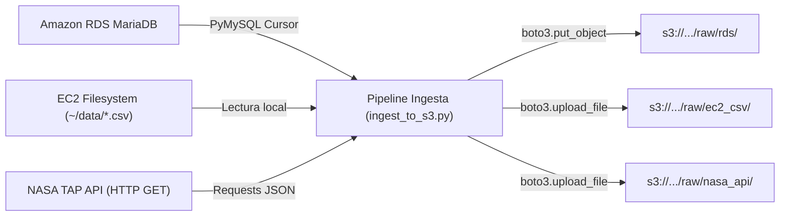

# Punto 3: Ingesta de Datos hacia el Data Lake (Amazon S3)

## 1. Introducción y propósito

El objetivo de este tercer componente es centralizar y automatizar la ingesta de las tres fuentes de datos heterogéneas construidas en el Punto 2 hacia la zona **RAW** del Data Lake en **Amazon S3**.

La zona **Raw** (o zona *Bronze* en la arquitectura Medallion) cumple el principio de almacenar los datos originales sin alteraciones, preservando la fidelidad de la información y garantizando la trazabilidad histórica antes de los procesos de limpieza y transformación en Spark y Glue (Punto 4).

---

## 2. Arquitectura del Data Lake en Amazon S3

El almacenamiento se organiza bajo la siguiente estructura de prefijos (carpetas virtuales) en el bucket:

```text
s3://<nombre-del-bucket>/
│
├── raw/                                <--- ZONA INGESTADA EN EL PUNTO 3
│   ├── rds/                            # Ingesta desde MariaDB
│   │   ├── stars/
│   │   │   └── stars.csv               # 4.862 estrellas anfitrionas
│   │   └── planetary_systems/
│   │       └── planetary_systems.csv   # 4.862 sistemas planetarios
│   │
│   ├── ec2_csv/                        # Ingesta desde el sistema de archivos de EC2
│   │   └── exoplanetas_catalogo.csv    # Catálogo de exoplanetas confirmados
│   │
│   └── nasa_api/                       # Ingesta desde el servicio web TAP
│       └── exoplanetas_parametros_api.json # Parámetros físicos y orbitales
│
├── trusted/                            # (Punto 4: Datos depurados con Spark/Glue)
└── gold/                               # (Puntos 6, 7 y 8: Tablas consolidadas para analítica)
```

---

## 3. Despliegue de la Infraestructura de Almacenamiento (IaC)

La infraestructura de almacenamiento se despliega mediante la plantilla de AWS CloudFormation:
📁 `03_ingesta_data_lake/infraestructura/datalake_s3.yaml`

Esta plantilla aprovisiona:
- **Bucket S3 único a nivel global:** Nombre formateado como `exoplanets-data-lake-<account-id>-<region>`.
- **Cifrado en reposo:** Servidor AES-256 habilitado por defecto.
- **Seguridad:** Bloqueo total de acceso público (*Block Public Access*).
- **Control de versiones:** *Versioning* habilitado para proteger los datos frente a sobrescrituras accidentales.

### 3.1. Despliegue desde la Consola de AWS CloudFormation
1. Ve a **CloudFormation → Stacks → Create stack (with new resources)**.
2. Selecciona **Upload a template file** y sube `datalake_s3.yaml`.
3. Configura el nombre del stack: `exoplanets-datalake-storage`.
4. Haz clic en **Next**, deja las opciones por defecto y presiona **Submit**.
5. Al finalizar (`CREATE_COMPLETE`), copia el valor de `BucketName` desde la pestaña **Outputs**.

### 3.2. Despliegue alternativo mediante AWS CLI
```bash
aws cloudformation create-stack \
  --stack-name exoplanets-datalake-storage \
  --template-body file://infraestructura/datalake_s3.yaml \
  --parameters ParameterKey=BucketPrefix,ParameterValue=exoplanets-data-lake
```

---

## 4. Configuración de Permisos en la EC2 (IAM LabRole)

Para que el script ejecutado en la instancia EC2 pueda escribir en el bucket de S3 sin almacenar claves secretas en texto plano:

1. En la consola de AWS, dirígete a **EC2 → Instances**.
2. Selecciona tu instancia `exoplanets-ec2`.
3. Haz clic en **Actions → Security → Modify IAM role**.
4. Selecciona el rol preconfigurado **`LabRole`** (en AWS Academy Learner Lab) y haz clic en **Update IAM role**.

*Esto otorga permisos automáticos a la instancia para interactuar con S3 mediante el SDK de AWS.*

---

## 5. Pipeline Automatizado de Ingesta (`ingest_to_s3.py`)

El proceso de extracción y carga está centralizado en el script de Python `ingest_to_s3.py`, el cual implementa las siguientes operaciones de manera secuencial y atómica:



1. **Ingesta MariaDB → S3 Raw:**
   - Conecta a la base de datos `exoplanets_db`.
   - Extrae `stars` y `planetary_systems`.
   - Genera los archivos CSV en memoria y los transmite a `s3://<bucket>/raw/rds/stars/stars.csv` y `s3://<bucket>/raw/rds/planetary_systems/planetary_systems.csv`.
2. **Ingesta Archivos EC2 → S3 Raw:**
   - Lee el catálogo `exoplanetas_catalogo.csv` generado en la EC2.
   - Lo transfiere directamente a `s3://<bucket>/raw/ec2_csv/exoplanetas_catalogo.csv`.
3. **Ingesta API NASA TAP → S3 Raw:**
   - Valida el archivo `exoplanetas_parametros_api.json` obtenido de la API web.
   - Lo transfiere directamente a `s3://<bucket>/raw/nasa_api/exoplanetas_parametros_api.json`.

---

## 6. Instrucciones de Ejecución Paso a Paso

### 6.1. Definir variables en la EC2
En la terminal de la instancia EC2:

```bash
# Nombre del bucket generado por CloudFormation
export S3_BUCKET="exoplanets-data-lake-<TU_ACCOUNT_ID>-us-east-1"

# Credenciales de conexión a MariaDB
export DB_HOST="<ENDPOINT_DE_TU_RDS>"
export DB_USER="admin_exoplanets"
read -s -p "Contraseña MariaDB: " DB_PASSWORD
echo ""
export DB_PASSWORD
```

### 6.2. Ejecutar el script automatizado
```bash
cd ~/Proyecto2_BigData/03_ingesta_data_lake

# Instalar dependencias
pip install -r requirements.txt

# Ejecutar el orquestador de ingesta
python ingest_to_s3.py
```

*Alternativamente, puedes usar el script bash contenedor:*
```bash
chmod +x run_ingestion.sh
./run_ingestion.sh
```

---

## 7. Validación y Verificación en Amazon S3

Una vez finalizada la ejecución, verifica que los objetos se encuentren en S3:

```bash
aws s3 ls s3://$S3_BUCKET/raw/ --recursive --human-readable
```

---


