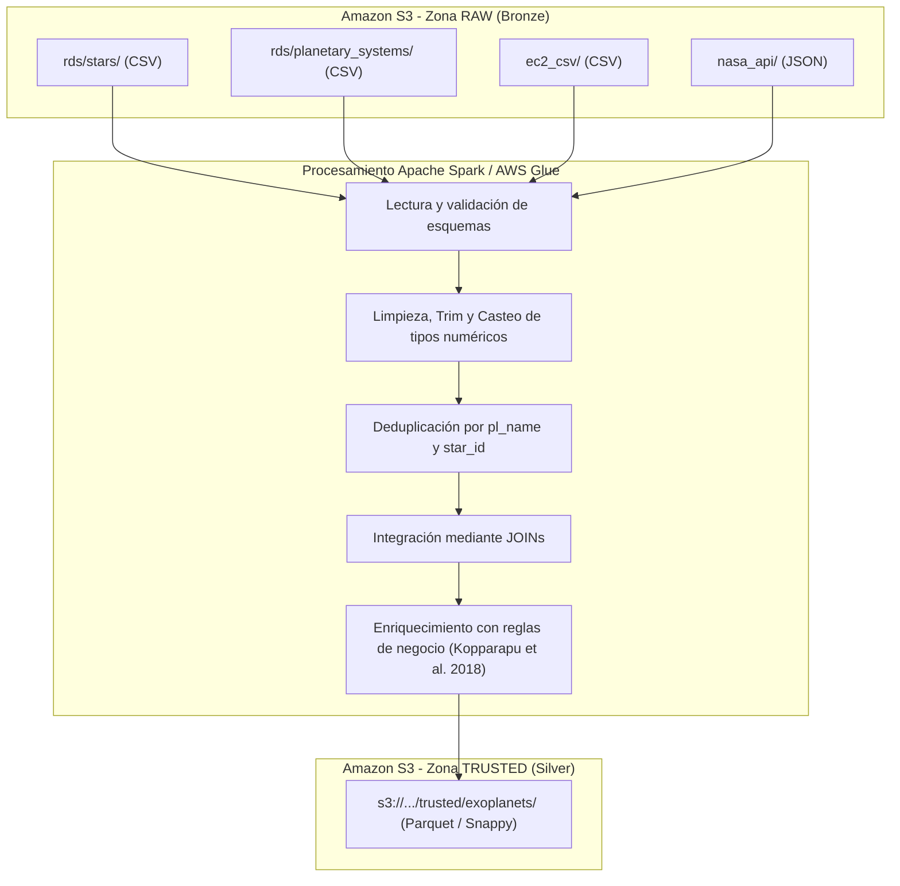

# Punto 4: Procesamiento y Preparación de Datos con AWS Glue y Apache Spark

## 1. Introducción y propósito

El propósito de este componente es transformar, limpiar, estandarizar e integrar los datos heterogéneos provenientes de la zona **RAW** (Bronze) y generar un conjunto de datos analítico, optimizado y catalogable en la zona **TRUSTED** (Silver) del Data Lake en **Amazon S3**.

Para este procesamiento distribuido se utilizan:
- **Apache Spark / PySpark:** Motor de computación distribuida en memoria para procesamiento masivo de datos.
- **AWS Glue:** Servicio ETL serverless administrado por AWS que ejecuta jobs de Spark a escala sin gestionar infraestructura de clusters.

---

## 2. Flujo del Pipeline ETL (RAW a TRUSTED)



---

## 3. Reglas de negocio y transformaciones aplicadas

### 3.1. Estandarización y Depuración
- **Trimming:** Eliminación de espacios en blanco al inicio y final de nombres de planetas (`pl_name`) y estrellas (`hostname`).
- **Casting de tipos:**
  - `pl_rade`, `pl_bmasse`, `pl_orbper`, `sy_dist`: Convertidos a `DoubleType`.
  - `sy_pnum`, `disc_year`, `star_id`, `system_id`: Convertidos a `IntegerType`.
- **Deduplicación:** Aplicación de `dropDuplicates(["pl_name"])` para garantizar unicidad a nivel de exoplaneta.

### 3.2. Integración de Fuentes (JOINs)
1. Unión interna (*Inner Join*) entre `stars` y `planetary_systems` sobre `star_id` para reconstruir la dimensión de sistemas estelares.
2. Unión izquierda (*Left Join*) entre el catálogo de planetas (`ec2_csv`) y los parámetros físicos de la API (`nasa_api`) mediante `pl_name`.
3. Unión izquierda (*Left Join*) del catálogo enriquecido con los sistemas estelares mediante `hostname`.

### 3.3. Clasificación Astronómica (NASA SDET / Kopparapu et al., 2018)
Se calcula la columna `size_category` según el radio del planeta ($R_\oplus$):

| Categoría | Condición de Radio ($R_\oplus$) |
|---|---|
| **Similar a la Tierra** | $0.5 \le R \le 1.0$ |
| **Super-Tierra** | $1.0 < R \le 1.75$ |
| **Subneptuniano** | $1.75 < R \le 3.5$ |
| **Neptuniano** | $3.5 < R \le 6.0$ |
| **Gigante gaseoso** | $6.0 < R \le 14.3$ |
| **Otro / No clasificado** | $R > 14.3$ o `NULL` |

### 3.4. Banderas Analíticas Adicionales
- `is_earth_similar`: Booleano que identifica planetas con radio entre $0.8$ y $1.25$ radios terrestres.
- `is_multiplanet_system`: Booleano que identifica si el sistema posee 2 o más exoplanetas confirmados (`sy_pnum >= 2`).

### 3.5. Formato de Salida en Trusted
- **Formato:** Apache Parquet (almacenamiento columnar optimizado para Big Data).
- **Compresión:** Snappy (equilibrio óptimo entre compresión y velocidad de descompresión).
- **Ruta de destino:** `s3://<bucket>/trusted/exoplanets/`.

---

## 4. Ejecución del Job en AWS Glue (Recomendado)

### 4.1. Crear el Job en AWS Glue Studio
1. En la consola de AWS, dirígete a **AWS Glue → ETL jobs**.
2. Selecciona **Script editor** y elige:
   - **Engine:** Spark.
   - **Start fresh** (Crear nuevo script).
3. Haz clic en **Create**.

### 4.2. Configuración del Job (*Job details*)
Ve a la pestaña **Job details** y configura:
- **Name:** `glue-exoplanets-raw-to-trusted`.
- **IAM Role:** Selecciona **`LabRole`** (rol estándar con permisos de Glue y S3 en AWS Academy).
- **Type:** Spark.
- **Glue version:** Glue 4.0 o superior (Spark 3.3+ / Python 3).
- **Language:** Python 3.
- **Number of workers:** 2 (mínimo recomendado para optimizar costos de laboratorio).
- **Job timeout:** 10 minutos.

En la sección **Job parameters** (al final de *Job details*), agrega el siguiente parámetro:
- **Key:** `--S3_BUCKET`
- **Value:** `<el-nombre-de-tu-bucket>` (ej. `exoplanets-data-lake-123456789-us-east-1`).

### 4.3. Cargar el Script
1. Vuelve a la pestaña **Script**.
2. Borra el código inicial y pega el contenido completo de:
   📁 [glue_raw_to_trusted.py](glue_raw_to_trusted.py).
3. Haz clic en **Save** en la esquina superior derecha.

### 4.4. Ejecución del Job
1. Haz clic en **Run** para iniciar el procesamiento distribuido.
2. Ve a la pestaña **Runs** para monitorear el progreso.
3. El estado cambiará de `Running` a **`Succeeded`** en aproximadamente 2 a 3 minutos.

---


## 5. Validación de Datos en la Zona Trusted

Una vez finalizado el procesamiento, verifica en la consola de AWS o mediante AWS CLI que los archivos Parquet se crearon en la zona `trusted/`:

```bash
aws s3 ls s3://<NOMBRE_DE_TU_BUCKET>/trusted/exoplanets/ --human-readable
```

### Esquema final de la tabla Parquet generada:

```text
root
 |-- pl_name: string (nullable = true)
 |-- hostname: string (nullable = true)
 |-- pl_rade: double (nullable = true)
 |-- pl_bmasse: double (nullable = true)
 |-- pl_orbper: double (nullable = true)
 |-- sy_dist: double (nullable = true)
 |-- sy_pnum: integer (nullable = true)
 |-- discoverymethod: string (nullable = true)
 |-- disc_year: integer (nullable = true)
 |-- disc_facility: string (nullable = true)
 |-- size_category: string (nullable = false)
 |-- is_earth_similar: boolean (nullable = false)
 |-- is_multiplanet_system: boolean (nullable = false)
```

---


