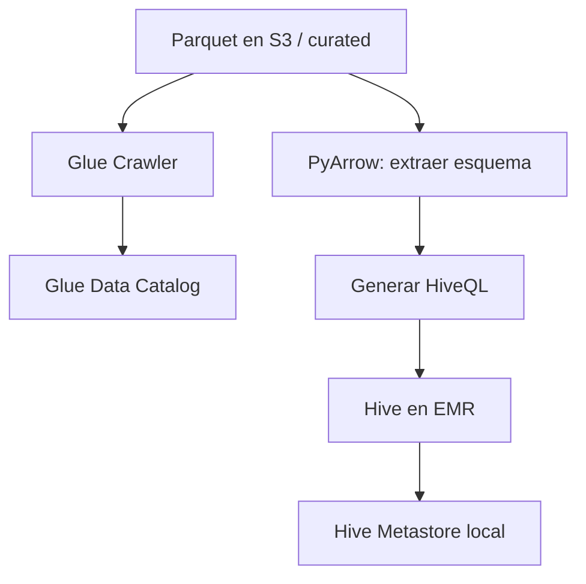

# Catalogación de tablas Parquet con AWS Glue y Apache Hive

## Descripción del punto

El objetivo es **catalogar los metadatos de un conjunto de datos** mediante dos herramientas diferentes: AWS Glue Crawler y Apache Hive sobre Amazon EMR.

La actividad se aplica a los **archivos Parquet existentes en una carpeta de Amazon S3 de la capa `curated`**. Ambos procedimientos utilizan el mismo origen y registran el esquema en catálogos independientes. **No se copian ni modifican los registros de S3**.

- **Glue Crawler:** descubre las columnas y los tipos de datos y registra una tabla en **AWS Glue Data Catalog**.
- **Hive:** Python extrae el esquema incluido en el Parquet mediante PyArrow y genera una sentencia HiveQL para crear una tabla externa. Hive la registra en el **Hive Metastore local de EMR**.

## Herramientas

| Herramienta | Propósito |
| --- | --- |
| Amazon S3 | Almacenar los archivos Parquet originales de `curated`. |
| AWS Glue Crawler | Descubrir automáticamente su estructura. |
| AWS Glue Data Catalog | Almacenar metadatos de las tablas descubiertas. |
| Amazon EMR | Ejecutar Apache Hive en un clúster administrado. |
| Apache Hive / Hive Metastore | Definir tablas externas y consultar metadatos y datos. |
| Python + boto3 | Automatizar el aprovisionamiento y los trabajos de AWS. |
| PyArrow | Obtener el esquema almacenado dentro del Parquet. |

## Estructura y responsabilidad de los archivos

```text
cataloging/
├── config.py
├── glue_catalog.py
├── hive_catalog.py
├── emr_cluster.py
├── main.py
├── requirements.txt
└── README.md
```

- **`config.py`:** lee los parámetros de AWS y los nombres de los recursos desde variables de entorno.
- **`glue_catalog.py`:** verifica o crea una base de datos lógica en Glue Data Catalog, crea el Crawler si no existe, lo ejecuta sobre la ruta S3 y muestra las tablas y columnas catalogadas. **El Crawler registra los metadatos en Glue**.
- **`hive_catalog.py`:** lee el esquema del Parquet con PyArrow, genera una instrucción `CREATE EXTERNAL TABLE`, la envía a Hive mediante un paso de EMR y ejecuta consultas de verificación. **Hive registra esa tabla en su metastore**.
- **`emr_cluster.py`:** crea, supervisa y permite terminar el clúster EMR que ejecuta Hive.
- **`main.py`:** coordina las dos catalogaciones y procesa los flags de ejecución.
- **`requirements.txt`:** contiene las dependencias de Python.

## Flujo de ejecución



Al ejecutar `main.py`, primero se realiza la catalogación con Glue. Luego se crea o reutiliza un clúster EMR, se envía la definición de tabla a Hive y se comprueba el estado del paso. Si se solicita, el programa termina el clúster al finalizar.

## Paso a paso de ejecución

### 1. Comprobar los requisitos

Se necesitan:

1. Una carpeta de S3 con archivos Parquet sin particiones y con esquemas compatibles entre sí. En nuestro caso, usaremos '/trusted', que es donde almacenamos la data después de sanitizarla.
2. Credenciales AWS vigentes y permisos para Glue, S3, EMR y `iam:PassRole` cuando corresponda, en nuestro caso, se usa credenciales dadas por AWS Academy.
3. Un rol IAM que Glue pueda asumir y que pueda leer la carpeta S3 (por ejemplo, `LabRole`, **solo si** tiene la confianza y permisos adecuados).
4. Roles existentes para el servicio EMR y sus instancias EC2, y una subnet con conectividad suficiente.
5. Python 3.10 o superior.

> **Sobre SSH:** el código original de creación de EMR no configura una clave EC2 (`Key Pair`) ni habilita la entrada al puerto 22. Por lo tanto no se puede establecer una conexión directa con esto, pero sí ejecutar los trabajos, pues estos pueden enviarse sin SSH a través de boto3. 

### 2. Instalar las dependencias

Desde la carpeta del proyecto:

```bash
cd 05_catalogacion
python -m pip install -r requirements.txt
```

### 3. Exportar las variables

En la terminal donde vas a ejecutar el programa, ajusta estos valores de ejemplo:

```bash
# variables obligatorios
export PARQUET_S3_URI="s3://mi-bucket/curated/usuarios/"
export GLUE_ROLE_ARN="arn:aws:iam::123456789012:role/LabRole"
export EMR_SUBNET_ID="subnet-xxx"

# varibales opcionales, cuentan con valor predeterminado que se indica a continuación 
export AWS_REGION="us-east-1"
export EMR_SERVICE_ROLE="EMR_DefaultRole"
export EMR_EC2_ROLE="EMR_EC2_DefaultRole"

export GLUE_DATABASE="curated_glue"
export GLUE_CRAWLER="curated-parquet-crawler"
export HIVE_DATABASE="curated_hive"
export HIVE_TABLE="curated_data"

export EMR_RELEASE="emr-7.12.0"
export EMR_INSTANCE_TYPE="m4.xlarge"
```

Opcionalmente, para conservar los registros de EMR en S3:

```bash
export EMR_LOG_URI="s3://mi-bucket-logs/emr/"
```
**Aclaración**: `PARQUET_S3_URI` debe señalar una **carpeta** y terminar en `/`.

### 4. Ejecutar la catalogación

Para crear EMR, ejecutar Glue y Hive y solicitar la terminación del clúster al finalizar:

```bash
python main.py --create-cluster --terminate-after
```

#### Flags disponibles

| Flag | ¿Qué hace? |
| --- | --- |
| `--create-cluster` | Crea un nuevo clúster EMR con Hive. **Genera costos de infraestructura**. |
| `--cluster-id j-XXXXXXXXXXXXX` | Utiliza un clúster EMR existente en lugar de crear uno nuevo. |
| `--terminate-after` | Solicita terminar el clúster que **esta ejecución acaba de crear**, incluso si falla el paso Hive. |

Debe indicarse **exactamente uno** de `--create-cluster` y `--cluster-id`.

Para reutilizar un clúster existente:

```bash
python main.py --cluster-id j-XXXXXXXXXXXXX
```

Este comando no termina el clúster. Si se usa `--create-cluster` sin `--terminate-after`, el clúster también permanece activo hasta que se termine manualmente o actúe la política automática de inactividad (el código establece 3600 segundos). Se debe verificar su terminación real en AWS para evitar costos innecesarios.

## Cómo verificar los resultados

### Glue: desde el Data Catalog

`glue_catalog.py` imprime los nombres de las tablas catalogadas y sus columnas. También se puede comprobar desde la interfaz de AWS:

1. Entrar a **AWS Glue → Data Catalog → Databases**.
2. Abrir la base de datos configurada en `GLUE_DATABASE` (por defecto `curated_glue`).
3. Entrar a **Tables**, abrir la tabla descubierta y revisar **columnas, tipos, formato Parquet y ubicación S3**.

### Hive: mediante los prints y, opcionalmente, desde EMR

Durante la ejecución, `hive_catalog.py` muestra:

- El archivo Parquet elegido para leer el esquema.
- El **HiveQL generado automáticamente** con la definición de la tabla.
- El **ID y el estado del paso EMR** enviado a Hive.
- La confirmación de que finalizó con `COMPLETED`.

El script HiveQL incluye `DESCRIBE FORMATTED` y `SELECT ... LIMIT 5`. **Sus resultados completos aparecen en el `stdout` de los logs del paso de EMR.** Se pueden consultar desde **EMR → Clusters → Steps → paso Hive → Logs**, si están disponibles; `EMR_LOG_URI` permite conservarlos en S3.

## Consideraciones importantes

- Los **datos siguen en S3**; solo se registran sus esquemas y ubicaciones.
- El catálogo de **Glue persiste** después de la ejecución. El **Hive Metastore local está en el nodo principal de EMR** y normalmente se pierde al terminar el clúster.
