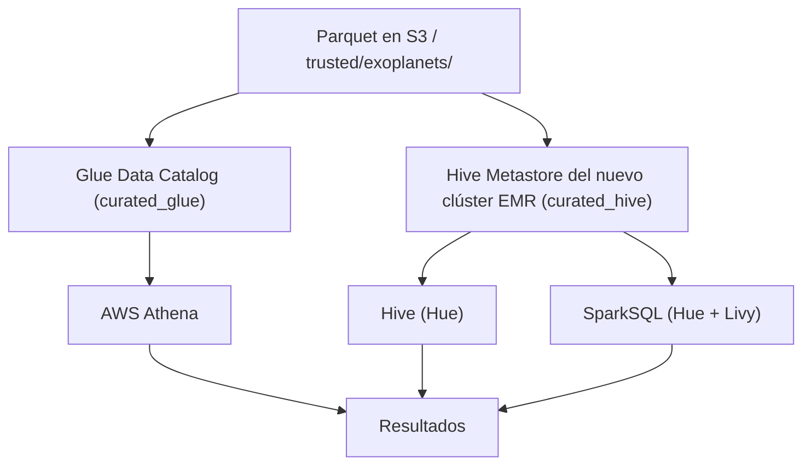

# Punto 6: Consultas y Procesamiento Analítico Descriptivo

## 1. Introducción y propósito

El objetivo de este componente es realizar el análisis descriptivo de los datos de exoplanetas mediante consultas SQL, ejecutadas con tres motores de procesamiento: **AWS Athena, Apache Hive sobre Amazon EMR y SparkSQL**.

Las consultas responden ocho preguntas de negocio sobre las características de los exoplanetas, sus sistemas planetarios, tamaños, masas, radios y periodos orbitales. Todas se ejecutan sobre los datos Parquet de la zona **TRUSTED** del Data Lake, sin copiarlos ni modificarlos. Se reutiliza la infraestructura existente y se crea un nuevo clúster EMR clonando el del Punto 5 desde la consola de AWS.

---

## 2. Flujo de Consulta



---

## 3. Preguntas de negocio y consultas

Cada pregunta tiene su propio archivo `.sql` en esta carpeta:

| N.º | Pregunta de negocio | Archivo |
|---|---|---|
| 1 | ¿Qué estrellas tienen mayor cantidad de exoplanetas confirmados? | [Sistemas con más planetas.sql](Sistemas%20con%20más%20planetas.sql) |
| 2 | ¿Cuáles son los diez exoplanetas con mayor radio? | [planetas_de_mayor_tamaño.sql](planetas_de_mayor_tamaño.sql) |
| 3 | ¿Qué exoplanetas tienen un radio cercano al de la Tierra? | [planetas_similares_a_la_tierra.sql](planetas_similares_a_la_tierra.sql) |
| 4 | ¿Cuáles son los diez sistemas planetarios más cercanos a la Tierra? | [sistemas_planetarios_mas_cercanos.sql](sistemas_planetarios_mas_cercanos.sql) |
| 5 | ¿Qué exoplanetas presentan los periodos orbitales más cortos? | [periodos_orbitales_mas_cortos.sql](periodos_orbitales_mas_cortos.sql) |
| 6 | ¿Cómo se distribuyen los exoplanetas según sus categorías de tamaño? | [distribucion_por_categorias_de_tamaño.sql](distribucion_por_categorias_de_tamaño.sql) |
| 7 | ¿Qué relación se observa entre la masa y el radio de los exoplanetas? | [relacion_entre_masa_y_radio.sql](relacion_entre_masa_y_radio.sql) |
| 8 | ¿Qué sistemas contienen exoplanetas de diferentes categorías de tamaño? | [diversidad_tamaño_por_sistema.sql](diversidad_tamaño_por_sistema.sql) |


---

## 4. Fuente de datos

- **Ubicación en S3:** `s3://exoplanets-data-lake-225180590593-us-east-1/trusted/exoplanets/` (Parquet, 13 columnas).
- **Glue / Athena:** base de datos `curated_glue`, tabla `exoplanets`.
- **Hive y SparkSQL (EMR):** base de datos `curated_hive`, tabla externa `exoplanets`. SparkSQL usa el mismo metastore que Hive.

El esquema es el generado en el Punto 4 (nombres de planeta y estrella, masa, radio, periodo orbital, distancia, método de descubrimiento y las columnas derivadas `size_category`, `is_earth_similar` e `is_multiplanet_system`).

---

## 5. Ejecución paso a paso

### 5.1. Clonar y configurar el clúster EMR

1. En la consola de AWS, abrir **Amazon EMR → Clusters**.
2. Seleccionar el clúster existente `cataloging-hive-practice`.
3. Abrir **Actions → Clone cluster** y revisar la configuración copiada.
4. En la configuración del software, comprobar que estén seleccionadas las aplicaciones **Hadoop, Hive, Hue, Livy y Spark**.
5. Seleccionar **Create cluster** y esperar a que el estado sea `WAITING`.

### 5.2. Acceder a Hue desde el computador personal

Hue se usa vía web, sin SSH ni llave `.pem`.

**1. Obtener la IP pública del computador** (terminal local):

```bash
curl -s https://checkip.amazonaws.com
```

**2. Identificar el Security Group del nodo principal** (desde la EC2 con AWS CLI configurado):

```bash
aws emr describe-cluster \
  --cluster-id ID_DEL_NUEVO_CLUSTER \
  --region us-east-1 \
  --query 'Cluster.Ec2InstanceAttributes.EmrManagedMasterSecurityGroup' \
  --output text
```

**3. Habilitar el puerto 8888 de Hue** solo para la IP del computador (desde la misma EC2):

```bash
aws ec2 authorize-security-group-ingress \
  --group-id ID_SECURITY_GROUP_MASTER \
  --protocol tcp \
  --port 8888 \
  --cidr IP_PUBLICA_DEL_COMPUTADOR/32 \
  --region us-east-1
```

**4. Obtener el DNS del nodo principal:**

```bash
aws emr describe-cluster \
  --cluster-id ID_DEL_NUEVO_CLUSTER \
  --region us-east-1 \
  --query 'Cluster.MasterPublicDnsName' \
  --output text
```

**5. Abrir Hue** en el navegador: `http://DNS_PUBLICO_DEL_MASTER:8888`. Iniciar sesión y entrar a **Query Editors**, desde donde se eligen los editores **Hive** y **Spark SQL**.

### 5.3. Catalogar los datos en Hive

Cada clúster EMR tiene su propio metastore local. Aunque la tabla ya se creó en el clúster original, hay que registrarla de nuevo en el nuevo. Los datos Parquet ya están en S3, por lo que no se repite la extracción ni la transformación.

En Hue, abrir **Query Editors → Hive** y ejecutar:

```sql
CREATE DATABASE curated_hive;

CREATE EXTERNAL TABLE curated_hive.exoplanets (
    pl_name STRING,
    hostname STRING,
    pl_rade DOUBLE,
    pl_bmasse DOUBLE,
    pl_orbper DOUBLE,
    sy_dist DOUBLE,
    sy_pnum INT,
    discoverymethod STRING,
    disc_year INT,
    disc_facility STRING,
    size_category STRING,
    is_earth_similar BOOLEAN,
    is_multiplanet_system BOOLEAN
)
STORED AS PARQUET
LOCATION 's3://exoplanets-data-lake-225180590593-us-east-1/trusted/exoplanets/';
```

Verificar el registro y la lectura de datos:

```sql
SHOW DATABASES;
SHOW TABLES IN curated_hive;
SELECT COUNT(*) FROM curated_hive.exoplanets;
```

### 5.4. Ejecutar las consultas en Hive

Con la tabla registrada, en **Query Editors → Hive** ejecutar las ocho consultas de la sección 3 sobre la tabla `curated_hive.exoplanets`.

### 5.5. Ejecutar las consultas en SparkSQL

1. En Hue, abrir **Query Editors → Spark SQL** (si está disponible).
2. Comprobar que la sesión esté conectada a Spark mediante Livy.
3. Verificar el acceso a la base de datos y la tabla:

```sql
SHOW DATABASES;
SHOW TABLES IN curated_hive;
SELECT COUNT(*) FROM curated_hive.exoplanets;
```

4. Si la tabla está disponible, ejecutar las mismas ocho consultas sobre `curated_hive.exoplanets`.

### 5.6. Ejecutar las consultas en Amazon Athena

Athena consulta los Parquet en S3 directamente, sin administrar un clúster.

1. En la consola de AWS, abrir **Amazon Athena** y seleccionar el grupo de trabajo del proyecto.
2. Abrir el editor de consultas, seleccionar la fuente `AwsDataCatalog` y la base de datos `curated_glue`.
3. Comprobar que aparece la tabla `exoplanets`.
4. En la configuración del grupo de trabajo, verificar que la ubicación de resultados sea `s3://exoplanets-data-lake-225180590593-us-east-1/gold/athena-results/`.
5. Ejecutar las ocho consultas sobre la tabla `curated_glue.exoplanets`.

---

## 6. Comparación de los motores

| Motor | Característica principal |
|---|---|
| AWS Athena | SQL serverless directamente sobre S3, usando el Glue Data Catalog. |
| Hive | SQL sobre el Data Lake mediante el entorno Hadoop de EMR. |
| SparkSQL | SQL con el procesamiento distribuido en memoria de Apache Spark. |

---

## 7. Consideraciones importantes

- Los datos permanecen en S3; los tres motores solo los leen.
- El catálogo de Glue persiste, pero el Hive Metastore local se pierde al terminar el clúster EMR (ver Punto 5). Se debe terminar el clúster al finalizar para evitar costos.
- La regla del puerto 8888 queda abierta en el Security Group del master; revocarla o terminar el clúster al acabar.
- Las consultas de `.sql` usan nombres de tabla sin prefijo; en cada motor hay que anteponer `curated_glue.` (Athena) o `curated_hive.` (Hive/Spark) o seleccionar la base de datos antes.
