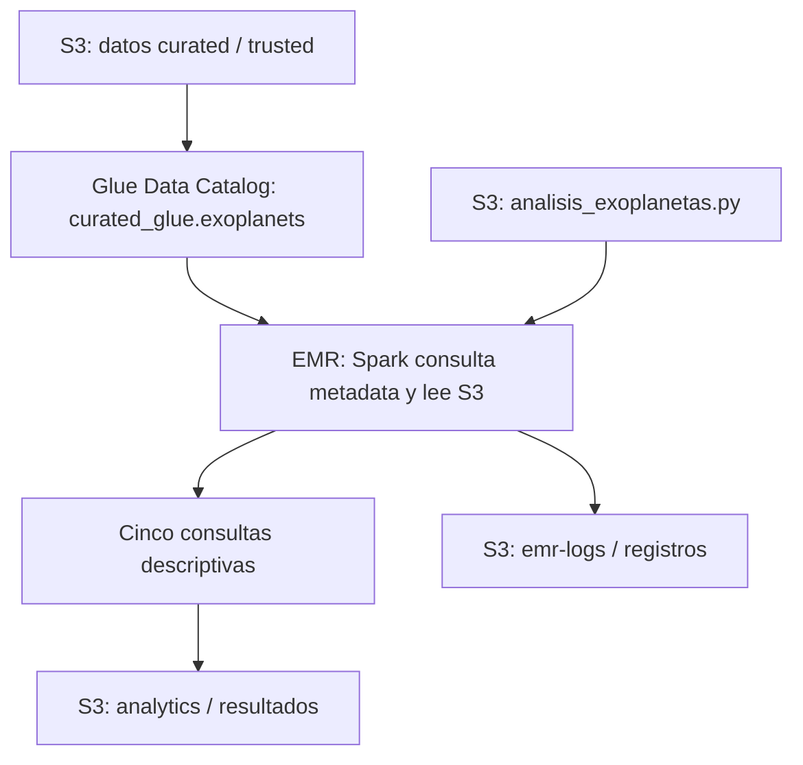

# Punto 7 — Análisis descriptivo de exoplanetas con PySpark en Amazon EMR

## Objetivo

Realizar consultas y procesamiento analítico descriptivo sobre el conjunto de exoplanetas del Data Lake, utilizando **Apache Spark con Python (PySpark)** en **Amazon EMR**. Los datos se consultan a partir de la metadata persistente de **AWS Glue Data Catalog** y los resultados se almacenan en **Amazon S3**, en la zona `analytics/`.

La pregunta general es: **¿qué características físicas y orbitales presentan los exoplanetas descubiertos, cómo han evolucionado sus descubrimientos y qué sistemas planetarios destacan por sus características?**

### Preguntas analíticas

1. **Distribución por tamaño:** ¿qué categorías de exoplanetas predominan y cuáles son sus radios, masas y periodos orbitales promedio?
2. **Descubrimientos:** ¿cómo ha cambiado el número de descubrimientos por década y qué métodos de detección predominan?
3. **Sistemas multiplanetarios:** ¿qué estrellas albergan más planetas y cuáles presentan mayor diversidad de tamaños?
4. **Proximidad:** ¿cuáles son los sistemas planetarios conocidos más cercanos a la Tierra y cuántos planetas se clasifican como similares a ella?
5. **Características físicas y orbitales:** ¿cómo varían las medianas de masa y periodo orbital según la categoría de tamaño?

## Herramientas y recursos

| Recurso | Función |
|---|---|
| AWS CLI | Crear, consultar y finalizar el clúster; agregar el Step |
| Amazon EMR | Administrar el clúster y ejecutar Spark |
| Apache Spark / PySpark | Leer la tabla catalogada, ejecutar las cinco consultas y escribir resultados |
| AWS Glue Data Catalog | Mantener la metadata de `curated_glue.exoplanets` |
| Amazon S3 | Almacenar el script, los datos de entrada, los resultados y los logs |
| IAM / VPC | Autorizar el acceso y proporcionar conectividad a los servicios |

El clúster tiene **1 nodo Primary** y **1 nodo Core**, ambos `m4.xlarge`, con EMR `7.14.0`. Es un clúster temporal de trabajo, aunque se mantiene encendido hasta finalizarlo explícitamente para poder depurar los Steps.

### Flujo de ejecución



Glue **no almacena los registros del dataset**: registra su esquema y ubicación. Los datos reales siguen en S3. Spark utiliza esa metadata para leerlos. El acceso mediante `spark.table(...)` requiere que EMR esté configurado para usar Glue como metastore y que la sesión habilite el soporte de Hive con `.enableHiveSupport()`.

## Ejecución paso a paso

### 1. Exportar variables

Ejecutar en la terminal que tenga AWS CLI configurada y permisos sobre EMR, Glue, IAM y S3:

```bash
export AWS_REGION="us-east-1"
export SUBNET_ID="subnet-xxxxxxxx"
export BUCKET="exoplanets-data-lake-ID_CUENTA-us-east-1"

export EMR_SERVICE_ROLE="EMR_DefaultRole"
export EMR_EC2_PROFILE="EMR_EC2_DefaultRole"

export METADATA_BD="curated_glue"
export METADATA_TABLE="exoplanets"
```

Sustituir el ID de cuenta y la subred por los valores reales. Los roles indicados son nombres de ejemplo **que deben existir** en la cuenta: usar los roles correspondientes si tienen nombres diferentes. El perfil EC2 debe poder consultar Glue, leer el script y los datos en S3 y escribir en `analytics/` y en la ubicación de logs; la red debe permitir el acceso a estos servicios.

### 2. Subir el script a S3

Desde la carpeta donde se encuentra `analisis_exoplanetas.py`:

```bash
aws s3 cp analisis_exoplanetas.py \
  "s3://$BUCKET/scripts/analisis_exoplanetas.py"
```

Este script es la aplicación PySpark: obtiene los argumentos, crea una sesión de Spark con `.enableHiveSupport()`, lee `curated_glue.exoplanets`, ejecuta cinco consultas, muestra resultados con `.show()` y escribe los archivos de salida en S3.

### 3. Crear el clúster EMR

```bash
aws emr create-cluster \
  --name "EMR-Analisis-Exoplanetas" \
  --region "$AWS_REGION" \
  --release-label emr-7.14.0 \
  --applications Name=Spark \
  --instance-groups \
    InstanceGroupType=MASTER,InstanceCount=1,InstanceType=m5.xlarge \
    InstanceGroupType=CORE,InstanceCount=1,InstanceType=m5.xlarge \
  --ec2-attributes "SubnetId=$SUBNET_ID,InstanceProfile=$EMR_EC2_PROFILE" \
  --service-role "$EMR_SERVICE_ROLE" \
  --configurations '[
    {
      "Classification": "spark-hive-site",
      "Properties": {
        "hive.metastore.client.factory.class": "com.amazonaws.glue.catalog.metastore.AWSGlueDataCatalogHiveClientFactory"
      }
    }
  ]' \
  --log-uri "s3://$BUCKET/emr-logs/" \
  --no-auto-terminate
```

**Qué se configura:** 
- versión y aplicación Spark

- grupos `MASTER` (Primary) y `CORE` (trabajador)

- subred y roles

- integración del catálogo de Glue mediante `spark-hive-site`

- directorio de logs en S3.

`--no-auto-terminate` conserva el clúster encendido tras cada Step.

### 4. Guardar el ID del clúster

El comando anterior devuelve un `ClusterId`. Exportar **el ID devuelto en esta ejecución**:

```bash
export CLUSTER_ID="j-REEMPLAZAR_CON_ID_REAL"
```

### 5. Esperar a que esté listo

```bash
aws emr wait cluster-running \
  --cluster-id "$CLUSTER_ID" \
  --region "$AWS_REGION"
```

Este comando espera hasta que EMR informe que el clúster está en estado `RUNNING`.

### 6. Enviar el Step de PySpark

```bash
aws emr add-steps \
  --cluster-id "$CLUSTER_ID" \
  --region "$AWS_REGION" \
  --steps "[
    {
      \"Name\": \"Analisis-Descriptivo-PySpark\",
      \"Type\": \"CUSTOM_JAR\",
      \"Jar\": \"command-runner.jar\",
      \"ActionOnFailure\": \"CONTINUE\",
      \"Args\": [
        \"spark-submit\",
        \"s3://$BUCKET/scripts/analisis_exoplanetas.py\",
        \"--analytic_path\",
        \"s3://$BUCKET/analytics/\",
        \"--metadata_db\",
        \"$METADATA_BD\",
        \"--metadata_table\",
        \"$METADATA_TABLE\"
      ]
    }
  ]"
```

`command-runner.jar` ya está incluido en EMR, **no se sube manualmente**. Sirve para ejecutar `spark-submit`. El script `.py` se obtiene de S3 y los tres flags siguientes llegan a `argparse` como pares `nombre` / `valor`:

| Argumento del script | Valor suministrado | Propósito |
|---|---|---|
| `--analytic_path` | `s3://$BUCKET/analytics/` | Prefijo S3 para las salidas |
| `--metadata_db` | `curated_glue` | Base de datos en Glue |
| `--metadata_table` | `exoplanets` | Tabla en Glue |

`ActionOnFailure=CONTINUE` permite que EMR permanezca disponible si este Step falla.

### 7. Comprobar el Step y las salidas

El comando `add-steps` devuelve un `StepIds`. Guardar el ID real:

```bash
export STEP_ID="s-REEMPLAZAR_CON_ID_REAL"
```

Esperar a la finalización exitosa:

```bash
aws emr wait step-complete \
  --cluster-id "$CLUSTER_ID" \
  --step-id "$STEP_ID" \
  --region "$AWS_REGION"
```

Consultar estado o errores:

```bash
aws emr describe-step \
  --cluster-id "$CLUSTER_ID" \
  --step-id "$STEP_ID" \
  --region "$AWS_REGION" \
  --query 'Step.{Estado:Status.State,Error:Status.FailureDetails}'
```

Verificar los directorios de resultados:

```bash
aws s3 ls "s3://$BUCKET/analytics/"
```

Se esperan cinco directorios: `q1_distribucion_tamano/`, `q2_descubrimientos_decada_metodo/`, `q3_sistemas_multiplanetarios/`, `q4_sistemas_cercanos/` y `q5_caracteristicas_por_categoria/`.

Para revisar los valores de las consultas, consultar **stdout** del Step en EMR o sus logs en `s3://$BUCKET/emr-logs/`. La función `.show()` escribe la representación textual del DataFrame en esos logs, mientras que `.write()` guarda los resultados en S3. Con Spark, cada salida es normalmente un **directorio con uno o más archivos `part-...` y un marcador `_SUCCESS`**.

### 8. Finalizar el clúster

Una vez comprobados los resultados:

```bash
aws emr terminate-clusters \
  --cluster-ids "$CLUSTER_ID" \
  --region "$AWS_REGION"
```

Opcionalmente, esperar la terminación:

```bash
aws emr wait cluster-terminated \
  --cluster-id "$CLUSTER_ID" \
  --region "$AWS_REGION"
```

**Importante:** al usar `--no-auto-terminate`, el clúster consume recursos hasta que se termine explícitamente; las salidas y los logs guardados en S3 sobreviven a la terminación.

## Análisis de resultados

Los siguientes hallazgos proceden de la ejecución proporcionad. Son resultados descriptivos de este conjunto de datos y no necesariamente representan la distribución real de todos los exoplanetas.

### Consulta 1. Distribución por categorías de tamaño

| Categoría | Planetas | Porcentaje | Radio promedio (radios terrestres) |
|---|---:|---:|---:|
| Subneptuniano | 2.056 | 31,78 % | 2,49 |
| No determinado | 1.631 | 25,21 % | Sin dato |
| Super-Tierra | 1.151 | 17,79 % | 1,40 |
| Gigante gaseoso | 725 | 11,21 % | 10,87 |
| Neptuniano | 369 | 5,70 % | 4,36 |
| Otro / No clasificado | 314 | 4,85 % | 16,93 |
| Similar a la Tierra | 224 | 3,46 % | 0,84 |

**Interpretación:** los subneptunianos son el grupo más numeroso (31,78 %). Si se suman las supertierras, representan el **49,57 %** del conjunto. Sin embargo, un **25,21 %** carece de categoría determinada, por lo que se debe evitar interpretar esta distribución como una descripción exhaustiva de tamaños conocidos. Los gigantes gaseosos presentan un radio promedio mucho mayor que las supertierras, consistente con su clasificación. Los promedios de masa o periodo orbital en grupos con valores extremos requieren especial cautela.

### Consulta 2. Descubrimientos por década y método

| decada | discoverymethod               | planetas |
| ------ | ----------------------------- | -------- |
| 1990   | Radial Velocity               | 27       |
| 1990   | Pulsar Timing                 | 3        |
| 2000   | Radial Velocity               | 285      |
| 2000   | Transit                       | 60       |
| 2000   | Imaging                       | 17       |
| 2000   | Microlensing                  | 10       |
| 2000   | Eclipse Timing Variations     | 1        |
| 2000   | Pulsar Timing                 | 1        |
| 2000   | Pulsation Timing Variations   | 1        |
| 2010   | Transit                       | 3078     |
| 2010   | Radial Velocity               | 462      |
| 2010   | Microlensing                  | 80       |
| 2010   | Imaging                       | 36       |
| 2010   | Eclipse Timing Variations     | 13       |
| 2010   | Transit Timing Variations     | 10       |
| 2010   | Orbital Brightness Modulation | 6        |
| 2010   | Pulsar Timing                 | 3        |
| 2010   | Astrometry                    | 1        |
| 2010   | Disk Kinematics               | 1        |
| 2010   | Pulsation Timing Variations   | 1        |
| 2020   | Transit                       | 1661     |
| 2020   | Radial Velocity               | 431      |
| 2020   | Microlensing                  | 204      |
| 2020   | Imaging                       | 45       |
| 2020   | Transit Timing Variations     | 19       |
| 2020   | Astrometry                    | 7        |
| 2020   | Eclipse Timing Variations     | 3        |
| 2020   | Orbital Brightness Modulation | 3        |
| 2020   | Pulsar Timing                 | 1        |

**Interpretación:** en los años noventa dominó `Radial Velocity` (27 registros, frente a 3 de `Pulsar Timing`). En la década de 2000, `Radial Velocity` siguió liderando (285) y `Transit` registró 60 descubrimientos. El patrón se invirtió de forma marcada en la década de 2010, cuando `Transit` registró **3.078** descubrimientos frente a **462** por velocidad radial. En la década de 2020, el tránsito sigue dominando (**1.661**), seguido de velocidad radial (**431**) y microlente gravitacional (**204**).

Esto muestra un **cambio en el método de detección predominante**, asociado a la evolución de las técnicas de observación; los datos por sí solos no permiten atribuir ese cambio a una misión o instrumento específico. Tampoco debe concluirse que los descubrimientos de los años 2020 disminuyeron: esa década está incompleta.

### Consulta 3. Sistemas multiplanetarios con diversidad de tamaños

| Sistema | Planetas | Categorías de tamaño determinadas | Distancia (pc) |
|---|---:|---:|---:|
| KOI-351 | 8 | 2 | 848,25 |
| TRAPPIST-1 | 7 | 2 | Sin dato |
| HIP 41378 | 6 | 3 | 106,29 |
| K2-138 | 6 | 2 | 202,59 |
| HD 110067 | 6 | 1 | 32,16 |

**Interpretación:** `KOI-351` lidera el listado por número de planetas registrados (**8**), seguido de `TRAPPIST-1` (**7**). Aunque `HIP 41378` tiene seis planetas, destaca por presentar **tres categorías de tamaño**, la mayor diversidad entre los diez sistemas mostrados. Tener más planetas no implica necesariamente tener más diversidad de tamaños: por ejemplo, `HD 110067` registra seis planetas en una sola categoría determinada.

La distancia de `TRAPPIST-1` aparece vacía en esta salida, lo cual evidencia la necesidad de distinguir **dato faltante** de **distancia cero**.

### Consulta 4. Sistemas más cercanos a la Tierra

| Sistema | Distancia (años luz) | Planetas registrados |
|---|---:|---:|
| Proxima Cen | 4,24 | 2 |
| Barnard's star | 5,96 | 4 |
| eps Eri | 10,45 | 1 |
| GJ 887 | 10,72 | 4 |
| Ross 128 | 11,01 | 1 |

**Interpretación:** `Proxima Cen` es el sistema más cercano del listado, a aproximadamente **4,24 años luz**, seguido de `Barnard's star`, a **5,96 años luz**. La consulta convierte distancias desde pársecs usando `1 pc ≈ 3,26156 años luz`.

En los diez sistemas presentados, el indicador `planetas_similares_tierra` es **0**, pero **esto no demuestra que no existan planetas parecidos a la Tierra en esos sistemas**. Todas las filas del resultado muestran `No determinado` en la categoría de tamaño, de modo que el cero refleja la clasificación disponible en este dataset y la lógica del indicador, no una conclusión astronómica definitiva.

### Consulta 5. Periodos orbitales y masas por categoría

| Categoría | Mediana periodo (días) | Mediana masa (masas terrestres) |
|---|---:|---:|
| Otro / No clasificado | 3,37 | 340,38 |
| Similar a la Tierra | 3,88 | 1,43 |
| Gigante gaseoso | 5,06 | 246,00 |
| Super-Tierra | 5,33 | 3,80 |
| Subneptuniano | 13,08 | 8,90 |
| Neptuniano | 13,75 | 19,10 |
| No determinado | 328,55 | 317,83 |

**Interpretación:** las medianas de masa aumentan desde la categoría similar a la Tierra (**1,43 masas terrestres**) hacia supertierras (**3,80**), subneptunianos (**8,90**), neptunianos (**19,10**) y gigantes gaseosos (**246**). En cuanto al periodo orbital, las medianas de los grupos con tamaños determinados se encuentran aproximadamente entre **3,88 y 13,75 días**, salvo el grupo no determinado, con **328,55 días**.

La mediana es especialmente útil porque existen máximos extremos: por ejemplo, **8.040.000 días** en `Otro / No clasificado` y **5.800.000 días** en `Gigante gaseoso`. Estos máximos también sugieren que conviene revisar unidades, calidad y valores extremos antes de interpretar promedios. Hay registros sin periodo orbital: en `No determinado`, solo **1.291 de 1.631** tienen ese valor.

## Conclusiones generales

1. **Predominio de tamaños intermedios:** subneptunianos y supertierras constituyen cerca de la mitad del dataset (49,57 %), pero el volumen de tamaños no determinados limita la interpretación.
2. **Cambio en los métodos de descubrimiento:** las detecciones por tránsito dominan desde la década de 2010, mientras que en las décadas anteriores predominó la velocidad radial.
3. **Diversidad planetaria:** el número de planetas por sistema no se corresponde necesariamente con la variedad de sus tamaños, como ilustran KOI-351 e HIP 41378.
4. **Proximidad y calidad de la clasificación:** los sistemas más cercanos se identifican correctamente con la distancia disponible, pero los valores `No determinado` impiden sacar conclusiones sólidas sobre la semejanza terrestre.
5. **Distribuciones con valores extremos:** para comparar periodos orbitales y masas, las medianas aportan una referencia más robusta que los promedios, especialmente en categorías heterogéneas.

En conjunto, el punto demuestra el uso integrado de **Glue como catálogo persistente, EMR con PySpark para procesamiento y S3 para resultados analíticos**, además de identificar restricciones de calidad que deben acompañar cualquier interpretación de los resultados.
