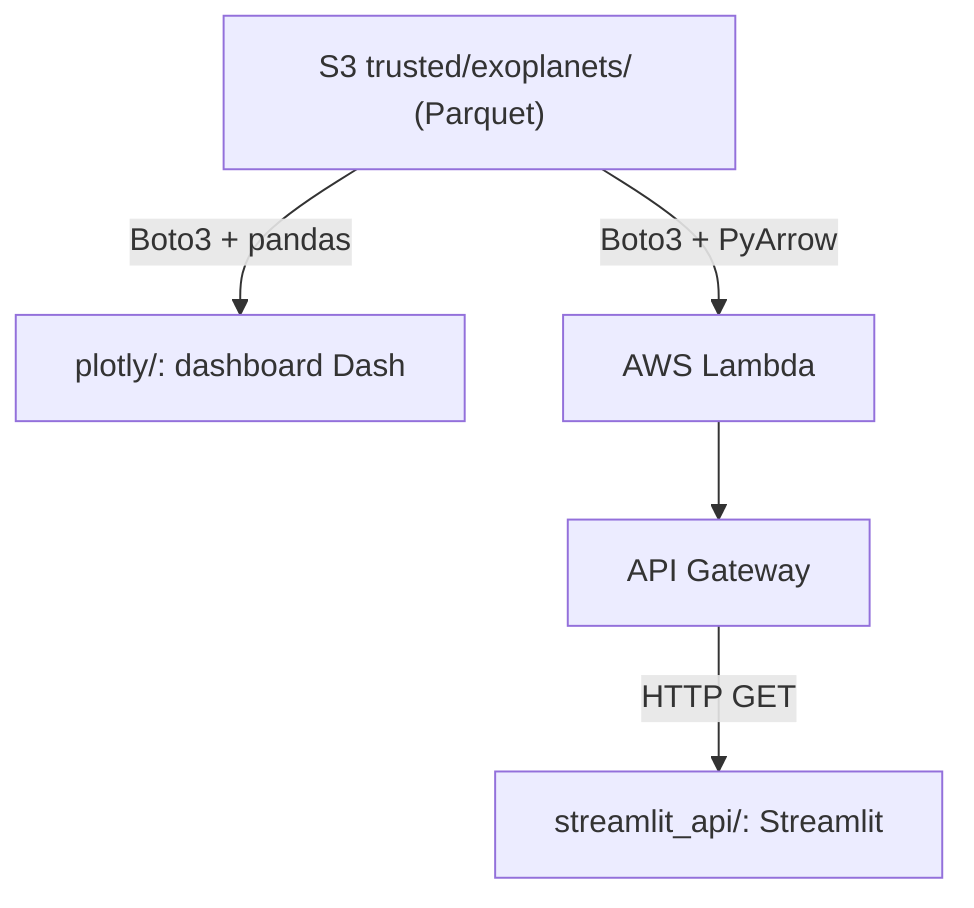

# Punto 8: Visualización de datos y aplicación con API

En esta fase se presentan los datos de exoplanetas de la zona **TRUSTED** del Data Lake (`s3://exoplanets-data-lake-225180590593-us-east-1/trusted/exoplanets/`) mediante dos aplicaciones diferentes:

- Un **dashboard de visualización** con Python, Plotly y Dash.
- Una **aplicación interactiva** con Streamlit, que consume una API expuesta mediante API Gateway y AWS Lambda.

---

## 1. Estructura

```text
08_visualizacion_api/
├── plotly/          # Parte 1: dashboard con Plotly y Dash
└── streamlit_api/   # Parte 2: Streamlit + API Gateway + Lambda
```

---

## 2. Contenido de cada carpeta

### 2.1. `plotly/`: dashboard de visualización

Lee el Parquet desde S3 y presenta cuatro gráficos interactivos (Top 10 de estrellas con más planetas, distribución por tamaño, relación masa-radio y descubrimientos por año) en un dashboard con Dash, "Explorador de Exoplanetas". También puede generar un HTML estático.

- Ejecución: `python app.py` y abrir `http://127.0.0.1:8050`.
- Detalle: [plotly/README.md](plotly/README.md).

### 2.2. `streamlit_api/`: aplicación con API Gateway

Aplicación Streamlit para buscar planetas, filtrar por categoría de tamaño y por similitud con la Tierra, ver la distribución por tamaño, los 10 exoplanetas de mayor radio y los 10 sistemas más cercanos. No lee S3 directamente: consulta por HTTP una API en API Gateway que invoca una función Lambda, y esta lee el Parquet.

- Ejecución: `streamlit run app.py`, con la variable `API_URL` apuntando a la API.
- Detalle y despliegue de Lambda y API Gateway: [streamlit_api/README.md](streamlit_api/README.md).

---

## 3. Arquitectura


