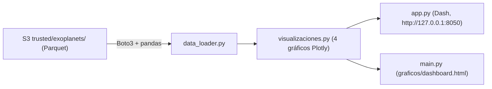

# Visualización de datos con Plotly y Dash

## 1. Introducción y propósito

Genera cuatro gráficos interactivos a partir del Parquet `s3://exoplanets-data-lake-225180590593-us-east-1/trusted/exoplanets/` y los reúne en un único dashboard con pestañas e indicadores: `graficos/dashboard.html`.

Los gráficos responden a las preguntas de negocio del Punto 6 y se presentan en una aplicación web hecha con Dash ("Explorador de Exoplanetas"). No se modifican ni se copian los datos de S3.

---

## 2. Flujo



---

## 3. Archivos

| Archivo | Función |
|---|---|
| `data_loader.py` | Lee el Parquet desde S3 con Boto3 (credenciales/rol IAM del entorno) o desde una ruta local. |
| `visualizaciones.py` | Crea los cuatro gráficos con Plotly. |
| `app.py` | Dashboard web con Dash "Explorador de Exoplanetas": dos secciones (pestañas) con dos gráficos cada una. |
| `main.py` | Punto de entrada: carga los datos y genera el dashboard (pestañas + indicadores). |
| `graficos/dashboard.html` | Dashboard generado. |
| `requirements.txt` | Dependencias. |

---

## 4. Gráficos

| Pestaña (Dash) | Pregunta | Gráfico |
|---|---|---|
| Sistemas y tamaños | 1 | Barras horizontales, Top 10 de estrellas |
| Sistemas y tamaños | 6 | Dona con cantidad y porcentaje |
| Masa-radio y descubrimientos | 7 | Dispersión log-log por categoría, Pearson y tendencia |
| Masa-radio y descubrimientos | Complementario | Líneas por año y método |

---

## 5. Ejecución del dashboard (Dash)

```bash
cd 08_visualizacion_api/plotly
python -m pip install -r requirements.txt
python app.py
```

Abrir `http://127.0.0.1:8050`.

Con credenciales AWS activas (rol de la EC2 o credenciales de Academy) lee de S3. Para pruebas locales con un archivo Parquet:

```bash
export DATASET_PATH="ruta/al/archivo.parquet"   # PowerShell: $env:DATASET_PATH="..."
```

Variables opcionales: `S3_BUCKET` y `S3_PREFIX`.

### Dashboard estático (opcional)

```bash
python main.py
```

Genera `graficos/dashboard.html`, un archivo autocontenido que se abre directamente en el navegador, sin servidor.
