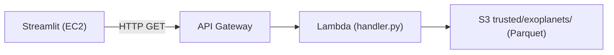

# Punto 8 (parte 2): Aplicación Streamlit con API Gateway y Lambda

Aplicación interactiva para consultar exoplanetas. El frontend (Streamlit) no lee el Parquet: pide todo por HTTP a **API Gateway**, que invoca una **Lambda** que lee `s3://exoplanets-data-lake-225180590593-us-east-1/trusted/exoplanets/` con Boto3 y PyArrow.



## Archivos

| Archivo | Función |
|---|---|
| `app.py` | Interfaz Streamlit: búsqueda, filtro por tamaño, checkbox "similares a la Tierra", tabla y gráfico de barras (Plotly). |
| `local_server.py` | Simula API Gateway en el puerto 3000 para pruebas locales (opcional). |
| `api_client.py` | Funciones que llaman a la API por HTTP (`requests`). La URL se toma de la variable `API_URL`. |
| `lambda/handler.py` | Backend: una sola Lambda con los endpoints. |
| `lambda/requirements.txt`, `requirements.txt` | Dependencias de Lambda y de Streamlit. |

## Endpoints

| Endpoint | Descripción |
|---|---|
| `GET /planets?q=Kepler-22` | Busca por nombre (contiene el texto, sin distinguir mayúsculas). |
| `GET /planets?size_category=Super-Tierra` | Filtra por categoría de tamaño. |
| `GET /planets?earth_like=true` | Solo planetas con `is_earth_similar = true`. |
| `GET /statistics/size` | Cantidad de planetas por categoría de tamaño. |

Los tres filtros de `/planets` se pueden combinar. Responde JSON, valida `earth_like` (`true`/`false`) y la longitud de los parámetros (400 si son inválidos), y devuelve como máximo 200 registros (`total` indica cuántos coinciden).

## Despliegue de AWS Lambda y API Gateway

La función Lambda consulta los datos de exoplanetas en Amazon S3 y se expone mediante una API HTTP de Amazon API Gateway.

### 1. Requisitos previos

- Cuenta de AWS Academy con acceso a los servicios necesarios.
- AWS CLI instalado y configurado, con credenciales temporales activas.
- Docker instalado para empaquetar las dependencias de Python compatibles con Lambda.
- Archivo `lambda_deployment.zip` generado previamente (contiene `handler.py` y las dependencias, incluido PyArrow).

```bash
aws --version
aws sts get-caller-identity
aws configure get region
```

La región utilizada es `us-east-1`.

### 2. Variables de entorno de la Lambda

Crear el archivo `lambda-env.json`:

```json
{
  "Variables": {
    "S3_BUCKET": "NOMBRE_DEL_BUCKET",
    "S3_PREFIX": "trusted/exoplanets/"
  }
}
```

Reemplazar `NOMBRE_DEL_BUCKET` por el bucket del proyecto.

### 3. Creación de AWS Lambda

```bash
aws lambda create-function   --function-name ExoplanetsQueryFunction   --runtime python3.12   --architectures x86_64   --role ARN_DEL_ROL_IAM   --handler handler.lambda_handler   --zip-file fileb://lambda_deployment.zip   --timeout 30   --memory-size 512   --environment file://lambda-env.json   --region us-east-1
```

`ARN_DEL_ROL_IAM` es el ARN de un rol que permita a Lambda leer el bucket S3 y escribir en CloudWatch (en Academy, `LabRole`). Verificar la función (estado esperado: `Active`):

```bash
aws lambda get-function-configuration --function-name ExoplanetsQueryFunction --region us-east-1
```

### 4. Creación de API Gateway

Crear la API HTTP y guardar el `ApiId` como `API_ID`:

```bash
aws apigatewayv2 create-api --name ExoplanetsHttpApi --protocol-type HTTP --region us-east-1
```

Crear la integración con Lambda y guardar el `IntegrationId` como `INTEGRATION_ID`:

```bash
aws apigatewayv2 create-integration   --api-id API_ID   --integration-type AWS_PROXY   --integration-uri ARN_DE_LAMBDA   --payload-format-version 2.0   --region us-east-1
```

Crear las rutas:

```bash
aws apigatewayv2 create-route --api-id API_ID --route-key "GET /planets"   --target "integrations/INTEGRATION_ID" --region us-east-1

aws apigatewayv2 create-route --api-id API_ID --route-key "GET /statistics/size"   --target "integrations/INTEGRATION_ID" --region us-east-1
```

Permitir que API Gateway invoque la Lambda:

```bash
aws lambda add-permission   --function-name ExoplanetsQueryFunction   --statement-id AllowApiGatewayInvoke   --action lambda:InvokeFunction   --principal apigateway.amazonaws.com   --source-arn "ARN_DE_API/*/GET/*"   --region us-east-1
```

Crear el stage con despliegue automático:

```bash
aws apigatewayv2 create-stage --api-id API_ID --stage-name '$default' --auto-deploy --region us-east-1
```

Los identificadores (`API_ID`, `INTEGRATION_ID` y ARN) se obtienen de las respuestas de los comandos anteriores. Los comandos sirven en Bash o PowerShell adaptando los saltos de línea.

## Configuración de Streamlit para consumir la API

Una vez desplegadas Lambda y API Gateway, Streamlit consume los endpoints publicados.

### 1. Configurar la variable de entorno

`API_URL` es la dirección base de API Gateway. Debe definirse en la misma terminal desde la que se ejecutará Streamlit.

**PowerShell (Windows):**

```powershell
$env:API_URL = "https://8pdd9pi79k.execute-api.us-east-1.amazonaws.com"
```

**Bash (Linux/macOS):**

```bash
export API_URL="https://8pdd9pi79k.execute-api.us-east-1.amazonaws.com"
```

### 2. Instalar las dependencias

Desde la carpeta `streamlit_api`, con el entorno virtual activado:

```bash
pip install -r requirements.txt
```

### 3. Ejecutar Streamlit

```bash
streamlit run app.py
```

Disponible en `http://localhost:8501`.

### 4. Funcionamiento de la aplicación

Streamlit consume la API mediante solicitudes HTTP con `requests`:

- Búsqueda de exoplanetas por nombre.
- Filtrado por categoría de tamaño.
- Selección de planetas similares a la Tierra.
- Resultados en una tabla.
- Gráfico de distribución de planetas por categoría de tamaño.

## Pruebas locales sin desplegar (opcional)

```bash
python local_server.py      # terminal 1: simula API Gateway en http://localhost:3000
streamlit run app.py        # terminal 2: sin definir API_URL usa localhost:3000
```
